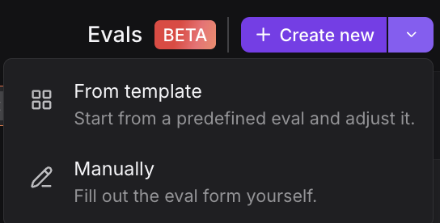
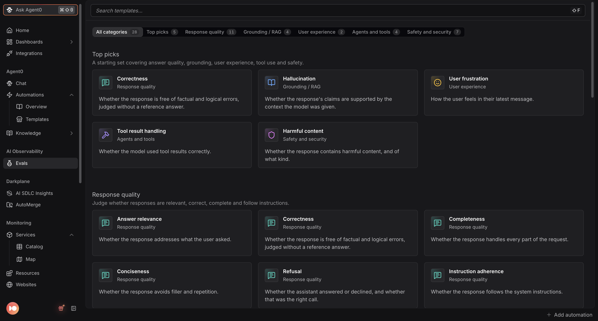
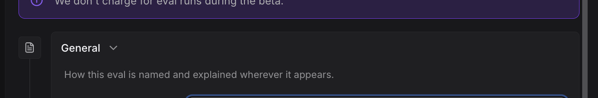
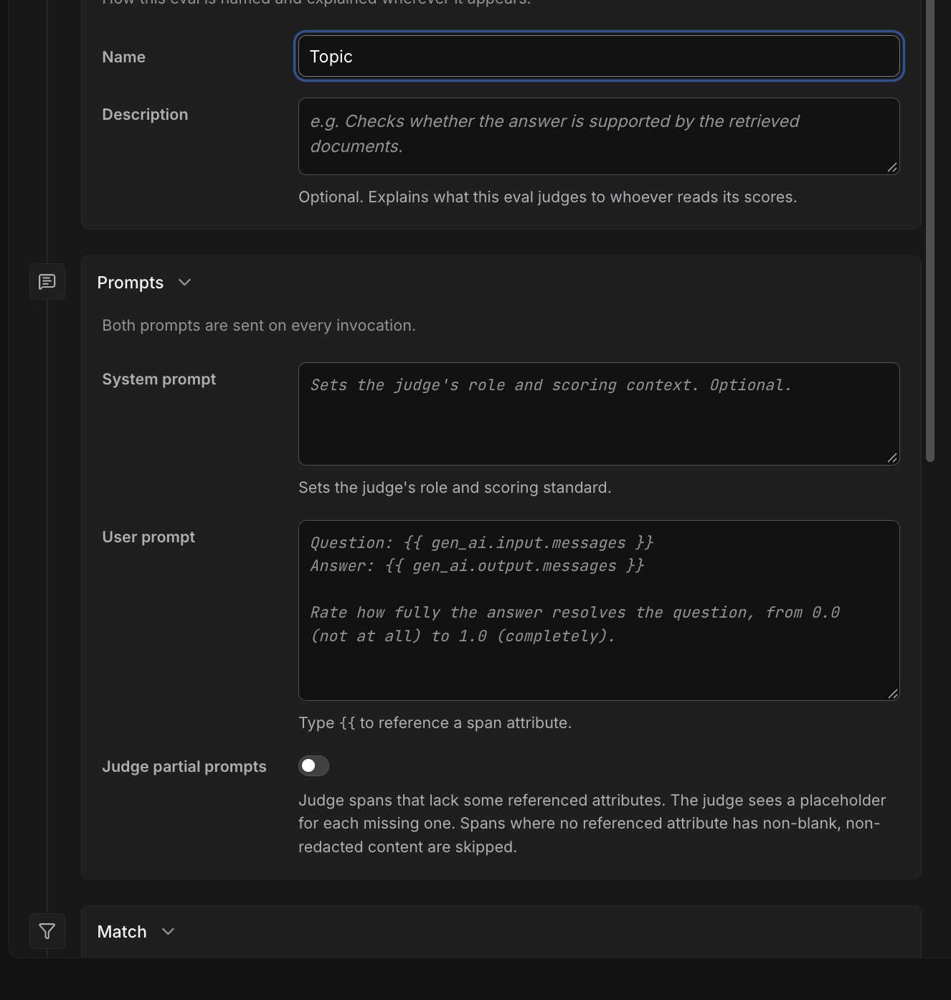
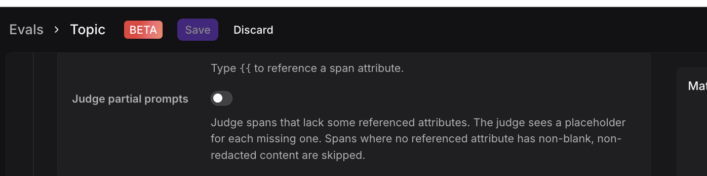
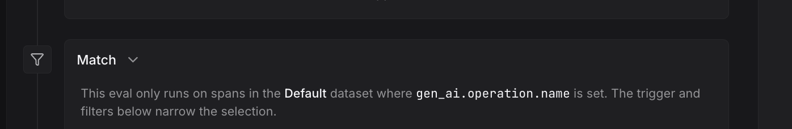
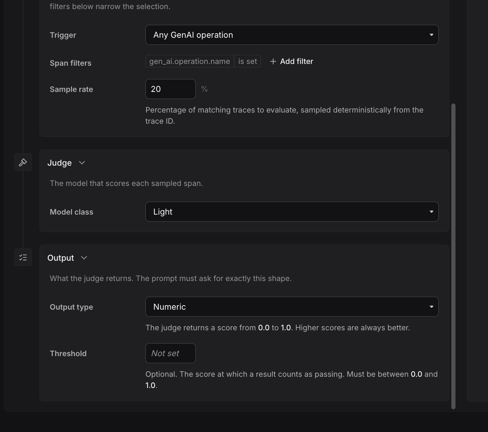

# Deployment Gate for LLM Eval Quality

The sample for the talk **When Your LLM Passes Every Check And Still Lies**.

A support agent retrieves the right refund policy (14 days) and then tells customers they have 30 days.
Every conventional check is green: HTTP 200, low latency, the tool was called, the question was answered.

This repo shows how to:

1. **Detect** it in production with Dash0 Evals (LLM-as-judge on OpenTelemetry GenAI spans).
2. **Export** failures into a regression test suite with DuckDB SQL.
3. **Gate** the next deploy in CI by scoring against that suite with [harness-evals](https://github.com/harness/harness-evals).
4. **Verify** the fix in production, and **automate** the loop with Temporal.

## Documentation

- **[Step-by-step guide](docs/guide.md)** — Build the sample from an empty folder, step by step, with all code and explanations.
- **[Slide deck](docs/When%20Your%20LLM%20Passes%20Every%20Check%20And%20Still%20Lies.pptx)** — The talk presentation.
- **[Talk recording](docs/When%20Your%20LLM%20Passes%20Every%20Check%20And%20Still%20Lies.pdf)** — Notes and visuals as a PDF.

Everything is Java except harness-evals, which is a Python tool that the CLI runs with `uvx`.

## What you need

| Tool | Why |
|---|---|
| Java 21 and Maven 3.9+ | Builds the agent and the CLI |
| [uv](https://docs.astral.sh/uv/) | Runs harness-evals with `uvx`, no virtualenv |
| A Dash0 account and the `dash0` CLI | Traces, evals, exports |
| An OpenAI API key, with credit bought | The agent runs on `gpt-4o-mini`, the CI judge on `gpt-6.1-terra` |
| Temporal CLI (optional) | `temporal server start-dev` for the incident workflow |

The OpenAI key needs an account with at least one credit purchase. Free-tier rate limits are far too low for a gate run; see [Troubleshooting](#openai).

## Why Dash0 Evals and harness-evals together

**Dash0 Evals** (production):
- Judge every request in production as it arrives, catching real-world regressions
- Can't gate a deploy: you only see what users actually send, not what breaks before it ships
- Requires observability infrastructure (OpenTelemetry pipeline)

**harness-evals** (CI):
- Gate a deployment by testing against a controlled golden dataset of known edge cases
- Catches regressions *before* they reach users
- Doesn't require production traffic; runs on committed test data

**Together** Dash0 catches new failure modes in production and feeds them back into the dataset, while harness-evals prevents known failures from being deployed again. Dash0 finds the bugs, harness-evals keeps them out.

## Build and configure

Copy `.env.example` to `.env` and fill in your keys. Then build both jars and check your setup:

```bash
cp .env.example .env
mvn -q package -DskipTests
alias evals-gate='java -jar cli/target/evals-gate.jar'
evals-gate check
```

This builds `agent/target/support-agent.jar` and `cli/target/evals-gate.jar`. Run everything from the repository root: the agent and the CLI both read `.env` from there. `evals-gate help` lists every command.

`evals-gate check` verifies your setup: it looks for Java 21+, Maven, `uv`, the `dash0` CLI, both jars, and `.env` with all required keys filled in. If all pass, it prints "all good" with your Java version. If anything is missing, it lists what to install or configure. This is your confirmation that you're ready to run the demo.

## Run the demo

This is the production-to-CI loop: detect failures in production with Dash0, export them into a golden dataset, and gate new code with harness-evals to prevent regressions. Follow these steps in order.

### 1. Prepare the evals in Dash0 (before sending traffic)

Create the evals now so they're ready when traffic arrives. Dash0 Evals don't backfill, so they must exist before spans arrive to judge them.

Go to Dash0 → AI Observability → Evals. You'll set up three evals: two from Dash0's built-in templates and one you'll create.

#### 1.1 Set up the Hallucination eval

First, click the **+ Create new** dropdown to choose between starting from a template or creating manually:


*Click **+ Create new** then choose **From template***

Then find the built-in templates:


*Find Hallucination under Grounding / RAG, and Answer relevance under Response quality*

**Create Hallucination (built-in)**

Find **Hallucination** in the Grounding / RAG section. This will check whether the agent's answer stays true to the policy it retrieved. Click **+ Create manually** and copy this configuration:
- Name: **Hallucination**
- Output: **Scalar** (scale of 0–1)
- Judge model: **Light**
- System prompt: "Determine if the response is grounded. Grounded = claims in the response are supported by facts in the context. Not grounded = claims are contradicted by or absent from the context. Score 0 = not grounded, 1 = grounded."
- User prompt: "Is the response grounded in the context?"
- Filters: Add two filters:
  - `service.name` `is` `support-agent`
  - `gen_ai.operation.name` `is_set` (leave value blank)

Click Save.

#### 1.2 Set up the Answer relevance eval

**Create Answer relevance (built-in)**

Find **Answer relevance** in the Response quality section. This will check whether the agent actually answered the customer's question. Click **+ Create manually** and copy this configuration:
- Name: **Answer relevance**
- Output: **Scalar** (scale of 0–1)
- Judge model: **Light**
- System prompt: "Determine if the response answers the question. Score 0 = does not answer, 1 = fully answers."
- User prompt: "Did the response answer the question?"
- Filters: Add two filters:
  - `service.name` `is` `support-agent`
  - `gen_ai.operation.name` `is_set` (leave value blank)

Click Save.

#### 1.3 Set up the Topic eval

**Create Topic (custom)**

Click **+ Create manually** and configure each section:

##### General section



- **Name:** Enter `Topic`
- **Description:** Enter `Classifies the customer's question by topic: billing, shipping, account, or other.`

##### Prompts section



- **System prompt:** Enter `Sets the judge's role and scoring context. Optional.`
- **User prompt:** Enter `Question: {{ gen_ai.input.messages }} Answer: {{ gen_ai.output.messages }} Rate how fully the answer resolves the question, from 0.0 (not at all) to 1.0 (completely).`
- **Judge partial prompts:** Leave toggled off

##### Match section



- **Trigger:** Leave as `Any GenAI operation`
- **Span filters:** Add two filters:
  1. Click the first field and select `gen_ai.operation.name`, set to `is_set`, leave value blank
  2. Click **Add filter** and add second filter: `service.name` `is` `support-agent`
- **Sample rate:** Leave as `20` %

##### Judge section



- **Model class:** Select `Light`

##### Output section



- **Output type:** Select `Numeric`
- **Threshold:** Leave as `Not set`

Click **Save**. All three evals are now set up and waiting for traffic.

### 2. Send traffic so the evals judge it

In terminal 1, start the agent with the bug, sending traces to Dash0:

```bash
java -jar agent/target/support-agent.jar --spring.profiles.active=dash0 --agent.variant=broken
```

In terminal 2, send 51 requests:

```bash
evals-gate traffic
```

After a few minutes, the evals will have judged all the requests. Open a `chat` span from `support-agent` in Dash0 and look at its **Evals** tab. Hallucination fails on the refund questions, while every other check is green.

**To capture (Evals on a single span)**:
1. In Dash0, navigate to Traces
2. Find a trace from `support-agent` (filter by service name if needed)
3. Open the trace and select the second `chat` span (the one with the final answer)
4. In the span details sidebar, click the **Evals** tab
5. Take a screenshot showing the three verdicts, with Groundedness failing


*Groundedness fails while Topic and Answered the question pass*

**To capture (Eval results across all spans)**:
1. In Dash0, navigate to AI → GenAI evaluation results
2. Look for a view that groups verdicts by eval name and label
3. Verify that Groundedness failures are clustered on billing questions, while Topic and Answered the question are mostly passing across all topics
4. Take a screenshot showing this distribution


*Groundedness failures cluster on billing, passes on shipping and account*

### 3. Export and slice with DuckDB

```bash
evals-gate export
evals-gate report
evals-gate cases
```

`report` shows the groundedness fail rate by topic: billing fails, the rest passes. `cases` writes `data/to_review.csv`. Fill in its `expected` column with the correct answer for each question and save it as `data/reviewed.csv`.

### 4. Build the golden dataset

```bash
evals-gate dataset
```

This writes `evals/billing-regressions.jsonl`. Commit it.

### 5. Run the offline evals

First prove the dataset catches the bug. With the broken agent still running in terminal 1:

```bash
evals-gate eval
```

The billing cases should fail. Then restart terminal 1 without `--agent.variant=broken` (the fixed agent), save the baseline and look for flaky cases:

```bash
evals-gate eval-baseline
evals-gate flaky
```

Commit `.evals/baselines/`. `flaky` runs the suite five times and lists cases whose outcome changes between runs.

### 6. The gate

This is what CI runs. It exits 0 against the fixed agent and 1 against the broken one:

```bash
evals-gate gate
```

### 7. Verify in production

After the fix is deployed and has had some traffic, compare the billing fail rate before and after the deploy time:

```bash
evals-gate export --from now-6h
evals-gate verify --deployed-at '2026-11-14 10:00:00+01'
```

## Without Dash0 or OpenAI

To run the DuckDB half without Dash0, use the bundled exports in `samples/`:

```bash
evals-gate samples
evals-gate report
evals-gate cases
evals-gate dataset
```

To rehearse the gate without OpenAI, start the stand-in model in terminal 1:

```bash
evals-gate rehearsal-model
```

Start the broken agent against it in terminal 2:

```bash
java -jar agent/target/support-agent.jar --agent.variant=broken --spring.ai.openai.base-url=http://localhost:9999/v1 --spring.ai.openai.api-key=rehearsal
```

Run the gate in terminal 3. It exits 1; restart terminal 2 without `--agent.variant=broken` and it exits 0:

```bash
evals-gate rehearse-gate
```

## Temporal

Start the dev server in terminal 1 and the worker in terminal 2:

```bash
temporal server start-dev
```

```bash
evals-gate temporal worker
```

Then, in terminal 3, start an incident with short waits for a demo, and follow it:

```bash
evals-gate temporal start --review-reminder PT2M --verify-after PT1M
evals-gate temporal status
```

After saving `data/reviewed.csv`, signal the review, and later the gate result:

```bash
evals-gate temporal review
evals-gate temporal gate --passed true --deployed-at '2026-11-14 10:00:00+01'
```

The workflow runs the same steps as the commands above: export, cases, a durable wait for the reviewer, dataset, an optional pull request (`OPEN_PR=true`), a wait for the CI gate, a 24-hour timer, and the before/after comparison. When billing hasn't recovered, it continues as new, up to three attempts. The Temporal Web UI at http://localhost:8233 shows the full history.

## CI

`.github/workflows/evals.yml` builds both jars, starts the fixed agent and runs `evals-gate gate` on every pull request, on every push to `main`, and nightly. It needs one repository secret:

```bash
gh secret set OPENAI_API_KEY --repo geertjanw/still-lies
```

### How the gate decides

harness-evals fails the run (exit 1) when **any** of these is true:

- a single case scores below its metric's own threshold in `evals/billing.eval.yaml`;
- a metric's average across all cases is below `--fail-under 0.8`;
- a metric dropped more than 0.05 below the stored baseline.

So good averages are not enough: one bad case fails the gate. `eval-baseline` refuses to save a baseline from a failing run. Exit 2 means the run never got as far as scoring: a configuration or setup error.

### Reading a failed run

Put the latest run's ID in a variable, then show the scores and every failing case with the judge's reason:

```bash
RUN=$(gh run list --repo geertjanw/still-lies --limit 1 --json databaseId --jq '.[0].databaseId')
gh run view $RUN --repo geertjanw/still-lies --log-failed | grep -E "\[FAIL\]|mean=" -A1
```

If the cases fail with `500` from `http://localhost:8080/answer`, the agent itself failed. Its log is in the run's `eval-results` artifact:

```bash
rm -rf /tmp/still-lies-ci
gh run download $RUN --repo geertjanw/still-lies -n eval-results -D /tmp/still-lies-ci
grep -m3 "Exception: " /tmp/still-lies-ci/agent.log
```

For a rerun, add `--attempt 2` to `gh run view`; without it, `--log-failed` can come back empty.

## Layout

| Path | What |
|---|---|
| `agent/` | The Spring Boot + Spring AI support agent and its policies |
| `agent/.../GenAiMessagesObservationFilter.java` | Puts the prompt and answer on the chat span, for the Dash0 evals |
| `dash0/evals/` | The three Dash0 evals as code |
| `sql/` | Every data step, in DuckDB SQL |
| `evals/` | The harness-evals config and the golden dataset |
| `.evals/baselines/` | The stored baseline the gate compares against |
| `cli/` | The `evals-gate` command line: steps, DuckDB over JDBC, Temporal, the rehearsal model |
| `.github/workflows/evals.yml` | The CI gate |
| `samples/` | Exports for running without Dash0 |

## Troubleshooting

### Shell and GitHub CLI

| Symptom | Cause and fix |
|---|---|
| `accepts 0 arg(s), received 10` after pasting a command with a `# comment` | zsh, the macOS default shell, doesn't treat `#` as a comment in an interactive shell, so the comment became arguments. Paste commands without comments, or run `setopt interactivecomments` once. |
| `zsh: no such file or directory: run-id` | A placeholder like `<run-id>` was pasted literally; zsh reads `<` as "read from file". Type the real run ID, without angle brackets. |
| `run or job ID required when not running interactively` | `gh run view` needs the run ID when its output goes into a pipe. Set `RUN` as under [Reading a failed run](#reading-a-failed-run). |
| `gh run watch`: `found no in progress runs to watch` | GitHub hadn't queued the run yet when you asked. Wait 10–15 seconds after a push and try again. |
| `--log-failed` prints nothing for a rerun | Add `--attempt 2` (or the attempt number). |

### OpenAI

| Symptom | Cause and fix |
|---|---|
| Agent log: `RateLimitException: 429: You have no credits remaining` | The API is prepaid and separate from a ChatGPT subscription. Buy credit at platform.openai.com → Settings → Billing, in the same organization as the key. $5–10 is plenty for this demo. |
| `429: Rate limit reached for gpt-4o-mini ... (RPM): Limit 10` or `gpt-4o ... Limit 3` | The organization is still on the free tier. A gate run needs about 50 calls in a minute or two. The first credit purchase upgrades the tier, but the API can take minutes to an hour to pick it up, even when the limits page already shows higher numbers. Test with 15 quick calls before rerunning CI. |
| The judge hits `gpt-4o` rate limits even on a paid account | New organizations get very low limits on older models. The judge now runs on `gpt-6.1-terra` (`judge_llm` in `evals/billing.eval.yaml`), a current model with normal limits and a low hallucination rate. |
| Latency failures of 10–20 seconds on a few cases | Usually rate limiting: the OpenAI SDK waits and retries, and the wait counts as latency. Fix the rate limits first. |

To test whether the agent's model is still rate-limited, paste your key after the first command, then run the loop:

```bash
read -s KEY
for i in $(seq 1 15); do curl -s -o /dev/null -w "%{http_code} " https://api.openai.com/v1/chat/completions -H "Authorization: Bearer $KEY" -H "Content-Type: application/json" -d '{"model":"gpt-4o-mini","messages":[{"role":"user","content":"hi"}],"max_tokens":1}'; done; echo
```

Fifteen `200`s means the limit is gone; `429` after about ten means you're still on the free tier.

### harness-evals and the gate

| Symptom | Cause and fix |
|---|---|
| Exit 2 with `httpx is required for async context manager usage` | harness-evals needs its `harness` extra to call an HTTP target. The CLI runs `harness-evals[llm,harness]==0.29.1`; an older checkout used `[llm]` only. |
| Exit 2 with `AnswerCorrectnessMetric.__init__() missing 1 required positional argument: 'embedding'` | `answer_correctness` can't be built from YAML in harness-evals 0.29.1. It's not in the config; the `geval` groundedness metric compares against the reviewed answers instead. |
| Exit 1 while every average is above 0.8 | One case scored below its own threshold. See [How the gate decides](#how-the-gate-decides). |
| Every case fails with `500` from `http://localhost:8080/answer` | The agent failed, usually on an OpenAI error. Read `agent.log` from the artifact. |
| The fixed agent fails groundedness with "the account policy does not give information about cancellation" | The model picked the wrong policy. The `lookup_policy` tool description now says which topic covers what (cancellations are refunds), and the system prompt says so too. |
| The fixed agent fails faithfulness at 0.50 | `faithfulness` checks every claim in the answer against the returned `context` only. Restating the customer's own details ("you bought it 40 days ago") counted as unsupported, so the agent now returns the question as context too, next to the policy text. Extra advice or offers the policy doesn't state also fail it; the system prompt forbids those. |
| `could not start uvx` | Install uv, or `pipx install 'harness-evals[llm,harness]==0.29.1'` (an installed harness-evals is used first). |
| `--update-baseline` exits 2 | No baseline exists yet. `.evals/baselines/initial.json` and `latest.json` must be committed. |

### Agent, Dash0 and DuckDB

| Symptom | Cause and fix |
|---|---|
| Chat spans in Dash0 without `gen_ai.input.messages` | Spring AI doesn't put the prompt and answer text on its spans by itself. `GenAiMessagesObservationFilter` must be registered as a bean, and the agent started with `--spring.profiles.active=dash0`. |
| Only some requests show up in Dash0 | Spring Boot samples 10 percent by default; `management.tracing.sampling.probability` is 1.0 in `application.yaml`. |
| Spans arrive, but no verdicts | Evals created after the traffic (no backfill), or a filter doesn't match `service.name = support-agent`. |
| Each request is judged twice | The eval is missing its `"finish_reason":"stop"` filter, so the tool-request span is judged too. |
| `run this from the repository root` | `cd` to the folder with `sql/` and `evals/`. |
| `dataset` writes 0 goldens | The `expected` column is empty, the `id` column was changed, or the CSV was saved with another separator. Save as plain UTF-8 CSV with commas. |
| DuckDB "could not set lock on file" | Two processes are writing `data/evals.duckdb`. Don't run `report` or `cases` by hand while the Temporal worker is in an activity. |
| `temporal start`: connection refused | Start `temporal server start-dev` first. |
